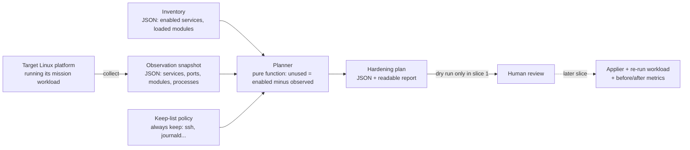

# Architecture: first vertical slice

The simplest complete version: take one observation snapshot of a running Linux system, compare it with what is enabled, and print a hardening plan. Nothing is changed on the system in this slice.

## Layers after slice 1

1. Collector that runs on the target (systemd units, `ss`, `/proc/modules`, process list) and writes the snapshot.
2. Applier with rollback, then re-run of the mission workload to prove nothing broke.
3. Metrics: units disabled, packages removed, listening ports closed, benchmark checks passed.
4. Deeper minimization: package removal, kernel config pruning, binary debloating.

## Design decisions

### 1. Plan from observed runtime use, not from a static checklist

- **Constraint:** the topic asks for the functions a platform actually needs, found from runtime information, on platforms with no design material.
- **Reasoning:** only observation of the real workload tells which services the mission uses; a checklist cannot know that a given autonomy stack needs a particular daemon.
- **Rejected alternative:** apply a STIG or CIS profile directly. It is strong on configuration but does not remove unused functions, and it can disable something the mission needs.
- **What breaks otherwise:** either attack surface stays (too little removed) or the vehicle stops working (wrong thing removed), with no evidence of which.

### 2. Dry run first, apply later

- **Constraint:** hardening must not break required functions, and the Q&A asks for minimal human time, not zero oversight.
- **Reasoning:** a plan file can be reviewed, diffed and tested before any change; applying is a separate step that can grow approval rules.
- **Rejected alternative:** apply changes as they are found. Faster, but one missed dependency bricks the platform with no record of why.
- **What breaks otherwise:** no rollback point and no audit trail for what was changed.

### 3. Planner as a pure function over JSON

- **Constraint:** two use cases (Navy-controlled and commercial black-box platforms) and repeated runs after every OS update.
- **Reasoning:** separating collection (platform-specific) from planning (platform-independent) lets the planner be unit-tested without a target and rerun on new snapshots.
- **Rejected alternative:** one script that inspects and decides in place. Less code now, but untestable without a live target.
- **What breaks otherwise:** every change to the logic needs a real device to test.

### 4. Python standard library only for slice 1

- **Constraint:** small Phase I budget, and the tool must run on minimal target images.
- **Reasoning:** Python is present on most Linux images and needs no extra install for the collector; no dependencies means nothing extra to harden.
- **Rejected alternative:** Go or Rust single binary. Better for deployment later; slower to iterate during feasibility.
- **What breaks otherwise:** time goes into tooling instead of the hardening question.
